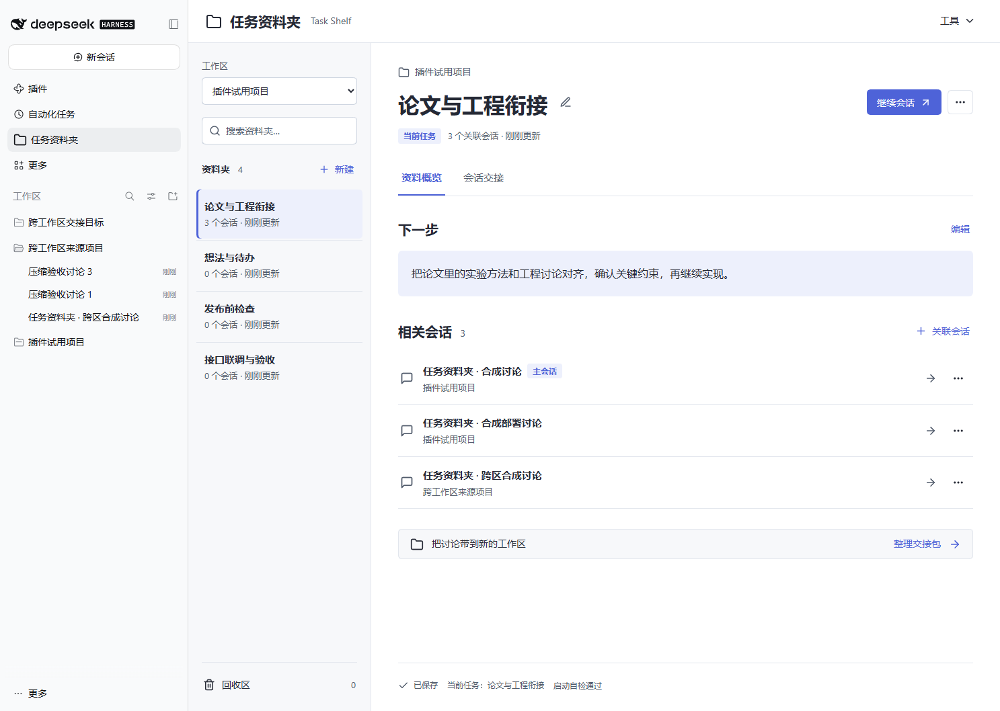

[](https://dsh.market/)
# DSH Task Shelf 1 · 任务资料夹

**DSH Task Shelf 1 社区试用版（包版本 1.1.1）。** 在交接区域直接按“工作区 → 会话”选择多个来源，合成一个交接包，并按需压缩。此前版本已在 **DSH 0.2.1-rc.3、0.2.1-rc.5 和 0.2.2-rc.1** 的隔离环境中测试；1.1.1 另在 **0.2.2-rc.2** 的隔离 Web 环境中验证。具体验证范围见 [验证记录](docs/TEST-RESULTS.md)。AI 适配使用模拟流测试，未验证真实模型质量、费用和日常桌面插件组合。

把相关会话和下一步放在一个资料夹里，下次回来继续工作。原会话不修改、不移动。默认本地精简不调用模型；用户选用 AI 摘要并点击生成或压缩时，会调用 DSH 默认模型，可能产生费用。带入新会话仍只准备草稿，不自动发送。



1.1.0 使用紧凑资料夹列表与详情布局，默认阅读，点击编辑后再保存。资料概览与会话交接分开显示，备份、导入、诊断归入工具菜单。支持深浅色与窄窗口列表/详情切换，保持原有数据格式。

1.1.1 修复旧压缩请求重放时的检查遗漏：返回缓存交接包前重新核对来源会话归属和资料夹版本；等待原操作完成后同样复核。正常重复请求仍复用原结果，不额外调用模型。界面和兼容范围沿用 1.1.0。

## 已实现

- 按工作区新建、改名、搜索资料夹，编辑下一步便签。
- 从不同工作区关联会话、设置主会话、打开会话和继续任务；原会话不移动。
- 每窗口独立的当前任务标记，回收区、恢复和永久删除。
- JSON 备份导出、预览后新增导入，同一备份阻止重复导入。
- 保存冲突保留草稿；结果不明时查询，原操作重试去重。
- 每次插件加载自动检查数据格式、上一代备份和目录临时文件读写；界面显示启动自检结果，可导出不含内容的诊断报告。
- 跨工作区、跨会话交接：在交接区域直接展开工作区，合选 1–5 段会话，不必先关联。两份材料均标明来源，支持分别编辑、复制下载和目标工作区草稿。
- 单段超过 12,000 字符时按所选方式自动压缩。整包超过 30,000 字符时停下，列出各段大小，让用户选择压缩哪一段。
- AI 摘要与本地精简可自由选择，界面说明优劣；本地精简保留开头与结尾，AI 摘要使用 DSH 默认模型提炼。压缩失败保留原内容，不静默换用其他方式。

文件引用、消息收藏、整份资料夹的 Markdown 导出、跨机器映射尚未实现（交接包可以下载）。历史设计 v0.2 中的完整功能和容量目标不是当前包的承诺。

## 双版本与压缩

默认左侧原始记录、右侧易读版。右上角可切换原始记录、易读版或并排查看；两份分别编辑且不会互相覆盖。输出版本默认易读版。未经压缩的来源展示原文；压缩后的来源明确标注为 AI 摘要或本地精简。重新生成或再次压缩会重新生成两份材料，替换编辑内容前会提示。

跨区示例：打开任意资料夹，切换到“会话交接”页签，展开 A、B 工作区，分别勾选讨论后生成一个包；若合计超限，选择压缩 B 的某段讨论。将交接目标设为 C，点击“带入新会话草稿”，检查后再发送。若 C 已有空白会话，DSH 会复用并追加草稿。交接选择不自动新增资料夹关联。范围限同一 DSH 环境，不支持跨机器或独立 profile 自动同步。

## 安装

见 [试用说明](docs/TRY-IT.md)。DSH → 插件 → 添加插件 → 安装第三方插件 → 填入本地包目录。

可在本仓库 Releases 页面下载对应版本的安装 ZIP，解压到长期保留的位置，再把其中直接包含 `package.json` 的目录填入 DSH。不要选源码 ZIP，也不要安装后删除该目录。另提供 `.tgz` 和 SHA-256 校验文件。npm 包发布并被市场索引识别后，也可通过市场安装；具体以市场显示的安装来源为准。

## 本地数据

数据保存在 `$DSH_HOME/task-shelf/state.json`；未设置 `DSH_HOME` 时为 `~/.dsh/task-shelf/state.json`。每次替换前保留上一代 `state.json.previous`。停用、卸载没有删除数据的逻辑。

试用限额：100 个资料夹（含回收区）、每个 50 个会话引用、便签 4096 字节、资料夹数据 2 MiB；加操作回执后状态文件最多 4 MiB。备份包含便签、会话标题和标识，请按个人资料保管。

原子写入和文件锁复用官方工具。坏文件不会被自动清空；官方写入工具没有 fsync，本版不提供断电持久性保证。

DSH Task Shelf 1 继续兼容 schema 1/2，不新增数据迁移。交接选择和压缩结果不写入任务状态。资料夹的跨区关联仍沿用上一修订的 schema 2；早期旧包不能读取它。更新前请导出备份；需要回退时请按试用说明保留升级前完整状态文件。

## 开发与证据

源码 `src/`，构建产物 `lib/`。无额外 UI 框架，React 由宿主提供。

```text
node scripts/build.mjs
node --test tests/*.test.mjs
node scripts/pack.mjs
```

测试需要目标 DSH 的 peer 包。详见 [实现记录](docs/IMPLEMENTATION.md)、[验证记录](docs/TEST-RESULTS.md)、[兼容性核对](docs/COMPATIBILITY.md)（与现有插件组合及宿主的静态核对，含未实测项）。[原始设计](docs/V1-PLAN.md) 和 [历史 AI 评审](docs/AI-REVIEW.md) 保留作后续参考。

独立社区项目，与 DeepSeek 官方无隶属关系。采用 [MIT 许可证](LICENSE)。欢迎通过 Issues 反馈；参与修改见 [贡献说明](CONTRIBUTING.md)，版本变化见 [更新记录](CHANGELOG.md)。

兼容范围允许更多 0.2.x 正式版，以及 0.2.1 与 0.2.2 的后续 RC；测试版本记录为 0.2.1-rc.3、0.2.1-rc.5、0.2.2-rc.1 和 0.2.2-rc.2，具体插件版本与验证范围见测试记录。其他版本可安装不等于已经测试；0.2.3-rc 等新的预发布版本仍需单独加入。
