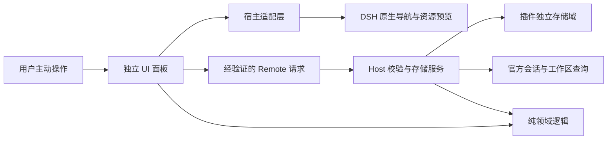

# 第一版产品与架构方案

版本：方案 v0.2（文档修订，未实现）  
日期：2026-10-28  
定位：独立社区插件，与 DeepSeek 官方无隶属关系。

## 1. 产品目标与边界

用户在多个会话和文件之间切换后，能通过一个任务资料夹找回“讨论到哪里、依据是什么、下一步做什么”。

示例：创建“登录异常排查”，关联两段会话、三个工作区文件、一条关键结论，以及“下一步验证 Safari”。重新进入时，从资料夹打开正确的会话和文件。

首版按任务组织已有资源。原生布局、对话渲染、编辑器、权限与 Agent 执行仍由 DSH 管理。基本侧栏持久化已是官方能力，本项目不以重新实现它为卖点。

## 2. 首版功能

| 功能 | 首版交付标准 | 边界 |
|---|---|---|
| 任务资料夹 | 新建、改名、移入回收区、恢复、按名称筛选 | 一个资料夹属于一个工作区；跨工作区组合后续评估 |
| 关联会话 | 用户选择既有会话，查看标题并打开 | 首版只读会话，不创建、删除、归档或自动发消息 |
| 关联文件 | 从所选工作区加入文件引用，经原生预览打开 | 不复制、编辑或删除原文件 |
| 关键消息 | 用户主动收藏，保留宿主提供的稳定消息标识、短摘录和备注 | 标识及收藏入口须验证；无精确定位接口时明确提示只能打开会话 |
| 下一步 | 一段可编辑纯文本便签 | 不自动交给模型执行 |
| 继续任务 | 有有效主会话时打开主会话；否则进入详情并提供选择 | 纯文件／便签资料夹仍可用；不批量启动模型、终端或浏览器连接 |
| 数据携带 | 导出版本化 JSON 和可读 Markdown | JSON 负责恢复，Markdown 仅供阅读；导入经检查、预览、重映射后整体提交 |
| 本地保存 | 重启后保留资料夹和引用 | 未保存编辑有明确提示，失败时保留输入并提供复制 |

首版暂不提供自动总结、全历史索引、云同步、跨插件布局恢复、终端恢复、批量 Agent 操作或模型工具。查看资料夹不产生模型请求。

## 3. 最小交互

侧栏增加一个“任务资料夹”入口，打开独立面板；使用 DSH 公开扩展位置，不覆盖主对话或替换原有侧栏。

列表展示：任务名、工作区、最近修改时间和下一步摘要。详情顶部展示任务名、当前任务标识、“继续任务”入口和完整的“下一步”；下方依次展示相关会话、关键消息、相关文件。避免用户先翻过资源列表才能看到要做什么。

### 3.1 当前任务与加入动作

- “当前任务”是客户端每个窗口／浏览器标签页、每个工作区独立的选择，不存为所有窗口共享的 Host 状态。首版仅在当前窗口生命周期内保留；重开窗口不自动猜测目标。
- 创建成功的资料夹设为该窗口、该工作区的当前任务，并显示名称；打开已有详情不自动改变当前任务，使用显式“设为当前任务”动作切换。
- 加入入口显示“加入：任务名”。没有当前任务时弹出本工作区选择器，并允许新建；不得静默加入最近修改的资料夹。
- 切换工作区时，只使用新工作区自己的有效选择；没有选择则保持未选中，不沿用旧工作区目标。请求发出时固定资料夹 ID、工作区和 revision，不能在回调里改用切换后的目标。
- 允许同一会话关联多个资料夹；同一资料夹内按已验证资源身份去重。存在多个候选时由用户选择，不依据会话的其他关联推断目标。
- 当前资料夹移入回收区、永久删除或失去访问条件后清除选择。其他窗口的变化最迟在下次操作时由 Host 拒绝并刷新提示，不为此新增后台轮询。

### 3.2 主会话与继续任务

- 会话列表提供“设为主会话”“取消主会话”动作；初次关联时不隐式指定主会话。
- 主会话指向本资料夹内一条已绑定的会话引用，而不是游离的 sessionId；主会话必须属于同一工作区。
- 用户取消关联主会话时，在同一次提交中清空主会话指针，不自动选择另一段对话。
- “继续任务”在主会话可访问时打开该会话；没有主会话或主会话已失效时进入资料夹详情，提示选择会话或重新关联。失效引用保留，不自动删除摘录或切换到其他会话。
- 临时无法验证与确认删除分别提示。没有会话、只有文件或便签的资料夹仍可正常使用；不要求创建新会话。
- 相关文件由用户逐个打开，不因点击“继续任务”批量打开文件或启动其他工具。

### 3.3 编辑、收藏与恢复反馈

- “新建资料夹”：名称 + 当前工作区。
- “加入：任务名”：关联当前会话或所选文件；使用宿主公开动作扩展点。缺少就近扩展点时，可降级为面板内显式选择，但仍须使用公开资源选择与校验接口。
- “收藏消息”：只处理用户选中的已完成消息；没有稳定消息标识时不伪装成可定位收藏，P1 必须确认入口或明确标记该能力不可用。
- “导出”：选择是否包含摘录和便签，先展示范围；完整备份默认包含回收区。去除摘录、备注或下一步的导出属于脱敏副本，不宣称能完整恢复被去除的内容。
- “移入回收区”：只改变资料夹记录，可恢复；永久清理需要显式确认。清理主会话引用时遵循同一事务约束。

编辑状态至少区分：未修改、未保存、保存中、已保存、冲突、结果待确认。纯文本编辑采用显式保存，未保存时关闭面板／切换资料夹要提示；请求中输入保留，只有 Host 确认提交且对应同一草稿版本后才显示“已保存”。结果待确认不能直接显示“保存失败”。宿主强制退出时不承诺恢复仅存在于内存的草稿。

冲突时保留本地输入与服务端新版本，提供“复制本地草稿”“重新加载服务端版本”；重新加载丢弃本地编辑前需确认。首版不做自动合并或强制覆盖。收到迟到响应时，不覆盖用户之后继续输入的内容。

错误信息说明影响和下一步，例如：“文件已不存在，其他资料仍可打开”“尚未确认是否保存，请先查询结果；你的输入仍保留在此”。不得把“请求已发出”显示成“已保存”。

UI 先中文，预留文案字典；原生主题、键盘焦点和高对比度优先。快捷键按宿主注册机制接入并可关闭，不抢占 Ctrl+K 等常用绑定。

## 4. 架构

采用单 npm 包，TypeScript，最小 Host 端 + 客户端 UI + 与宿主无关的领域逻辑。沿用 DSH 的 UI 运行时，避免打包第二份框架。



职责：
- **core**：数据校验、排序筛选、去重、版本冲突判断、导入计划等纯逻辑。
- **host**：身份及对象归属校验、限额、持久化、并发控制和导出数据组装。
- **client**：按需加载面板，显示状态，提供正常及降级导航。
- **adapter**：集中封装当前 DSH 的会话、工作区、资源、存储和生命周期接口。DSH 变动优先在此消化。

不暴露原始 SQL、任意路径读写或通用命令执行接口。UI 不扫描磁盘，不自动读取全部聊天记录。代码中“只读”是行为约束，不是操作系统强制隔离。

## 5. 数据模型与限额

### 5.1 记录、来源与本地绑定

以下为设计示意，不是已实现接口。落地前对照目标 DSH 的正式类型；持久化记录、Host 返回的引用状态、导出格式分别校验。

```ts
type ReferenceState = 'unresolved' | 'resolved' | 'missing' | 'unavailable';
type SessionLocator = { sessionId: string };
type MessageLocator = { sessionId: string; messageId: string };
type FileLocator = { relativePath: string };

interface ResourceRef<T> {
  id: string; // 插件本地引用 ID
  source?: {
    originId: string; // 数据来源的随机标识，不是认证凭据
    workspaceId: string;
    locator: T;
  };
  binding?: { workspaceId: string; locator: T }; // Host 验证后建立
}

interface ReferenceView<T> {
  reference: ResourceRef<T>;
  state: ReferenceState; // Host 按当前检查结果返回，不信任导入值
}

interface TaskShelf {
  id: string;
  workspaceId: string; // 当前宿主工作区
  title: string;
  nextStep: string;
  primarySessionRefId?: string; // 指向本记录中的已绑定会话引用
  sessionRefs: Array<ResourceRef<SessionLocator> & { titleSnapshot?: string }>;
  messageRefs: Array<ResourceRef<MessageLocator> & {
    excerpt: string;
    note: string;
  }>;
  fileRefs: Array<ResourceRef<FileLocator> & { label?: string }>;
  revision: number;
  createdAt: string;
  updatedAt: string;
  deletedAt?: string;
}
interface ExportEnvelope {
  format: 'dsh-task-shelf';
  schemaVersion: number;
  exportId: string;
  originId: string;
  pluginVersion: string;
  hostVersion?: string; // 无法获得时省略，不推断版本
  exportedAt: string;
  scope: {
    kind: 'full' | 'selected';
    includesDeleted: boolean;
    omittedFields: Array<'excerpt' | 'note' | 'nextStep'>;
  };
  shelves: TaskShelf[];
}
```

工作区、会话及消息 ID 由宿主产生；资料夹和引用 ID 由插件产生。`primarySessionRefId` 替代游离的 `primarySessionId`，取消关联时可在同次提交中保持一致性。所有本地绑定必须属于资料夹的当前工作区。

文件只保存工作区相对路径；不把导入的绝对路径直接交给文件接口。格式版本、插件版本和宿主版本分别记录。`originId` 不包含主机名、用户名或绝对路径，也不参与授权；导入包即使声称来自本机，其绑定仍需重新验证。

引用状态语义：
- `unresolved`：尚无已确认的本地绑定；允许保留来源、摘录、备注和标签。
- `resolved`：本次检查确认本地目标可访问；打开前仍走宿主授权，不把历史检查当成永久授权。
- `missing`：对有权查询的目标，宿主明确确认已删除或不存在；保留绑定线索和用户内容，不自动删引用。
- `unavailable`：暂时断连、权限不足、消息尚未加载或接口无法判定；不冒充目标已删除。

状态由 Host 检查结果派生；导入状态不能直接变为 `resolved`。首版在打开详情、执行导航和用户主动重试时按需检查，不新增后台扫描。摘录和备注的保留不依赖目标是否仍然存在。

### 5.2 跨环境映射与导出语义

- 导入 ID 仅作来源线索。默认生成新的本地资料夹及引用 ID，重置 revision；原主会话引用只有在完成 ID 映射且目标验证成功后才设为本地主会话。
- 用户逐组确认目标工作区；会话不得按标题猜测绑定。会话重映射不等于消息重映射，消息须对新的会话独立验证，否则保留为待关联。
- 文件预览必须显示目标工作区与相对路径，并由用户确认映射；同名文件存在不等于它就是原文件。确认后仍由 Host 校验归属与路径边界，不能越过原生预览权限。
- 导出中记录的本地绑定归属于导出包的 `originId`；既有 `source` 保留为历史来源。再次导入时，二者均是线索，不直接成为新环境的绑定。
- 完整 JSON 备份默认包含回收区、摘录、备注和下一步；用户选择脱敏时，将相应文本置空并记录 `omittedFields`，明确标为不能恢复这些内容的副本。Markdown 仅供阅读，不承担恢复协议。
- 同版本完整导出的 JSON，在目标存储有足够空间且未超记录数量限额时，必须可完整导入；外部会话和文件不在备份内，内容恢复不代表外部引用一定可用。

### 5.3 初始保护限额

以下是待实测的设计限额，不是已通过的性能数据：
- 最多 500 个资料夹；每个最多 50 个会话、100 条消息引用、100 个文件引用。
- 标题 120 个 Unicode 码点；下一步和单条备注各最多 4 KiB UTF-8；摘录最多 1 KiB。其他 ID、快照标题、标签与版本元数据也必须有 schema 长度上限，不接受无界字符串。
- 普通 Remote 请求最多 64 KiB，按实际序列化后的 UTF-8 字节计。普通响应同样设置 64 KiB 上限；列表只返回摘要，详情中的引用分页读取，页大小同时受项数和字节数约束。
- 编辑使用单字段／单条引用等增量操作，不提交整个资料夹。一个合法资料夹可能大于 64 KiB，必须可分次读取、编辑；列表每页最多 50 项，下一步只返回有界摘要。
- 活跃记录逻辑容量最多 20 MiB，包含软删除记录，按规范化记录 JSON 的 UTF-8 序列化总量计，不按数据库文件大小计。达到限额时拒绝增加容量的写入，但仍允许导出、删除和减量编辑；软删除不释放额度。
- JSON 导出与导入文件使用统一的 32 MiB 上限，含封装元数据；导出使用紧凑 JSON。必须以最大合法数据集验证“完整导出大小不超过导入上限”，不能静默裁剪或遗漏记录。主动导入超额记录时整体拒绝，用户可先清理或选择较小范围，不自动覆盖现有资料夹。
- 导入／导出走单独的有界传输路径；经普通 Remote 时，每块原始数据最多 32 KiB，连同编码和封装后仍不得超过 64 KiB。完整导入文件最多 32 MiB，不通过放宽普通请求上限实现。
- 每个插件存储域最多一个未完成导入作业，暂存输入最多 32 MiB，待提交记录集合最多 20 MiB；记录配额、暂存空间和备份分开计量。备份轮换最多 3 份，每份也有明确大小上限（不超过完整 JSON 备份上限 32 MiB）。启动导入／迁移前检查临时空间，不能把 20 MiB 活跃限额宣传成磁盘总占用。
- 搜索只检索本插件记录，不索引会话正文。服务端执行全部限额，拒绝超限时保留旧数据和可导出能力，不静默删除旧数据。

## 6. 持久化与写入协议

### 6.1 存储选择门槛

优先使用目标 DSH 的公开存储域。技术验证阶段必须确认：
1. 单条增量修改及主会话关联变化是否有事务或等效原子提交能力。
2. 多请求／多窗口是否支持版本条件写入或可实现可靠串行化。
3. 异常退出后是否保留旧完整记录。
4. 数据是否与插件包文件分离，卸载是否保留。
5. 同一 DSH_HOME 多宿主进程下的写入约束。
6. 业务变更与幂等操作结果能否一并持久化，导入候选数据能否原子切换。

仅有进程内互斥不能宣称跨进程安全。若公开存储无法满足要求，应记录限制并选择经评审的独立存储适配方案；不默认用读改写 JSON 伪装事务。此决策完成前不发布“数据可靠”的声明。

### 6.2 普通写入、冲突与结果确认

- 修改、取消关联、移入／恢复回收区及永久清理都携带预期 revision；Host 在同一原子操作中校验并更新。冲突返回当前版本信息，不执行最后写入者覆盖。
- 创建、修改、删除及导入提交携带客户端生成的 `operationId`。Host 将授权范围、操作种类、规范化请求摘要和结果与提交绑定；同一标识、相同请求重放返回原结果，同一标识、不同请求拒绝。查询结果也必须校验工作区和请求者访问条件。
- 幂等记录必须持久化并有保留期和数量／容量上限；P1 确定并测试具体值，发布前写入接口契约。不得为了接收新请求提前驱逐有效期内回执；达到限额时明确拒绝新的受影响写入，仍保留查询与导出路径。过期或无法确定的操作不能自动当成“从未执行”。
- 请求超时、连接断开或取消等待后，UI 进入“结果待确认”，保留草稿和原 `operationId`，按需查询提交结果。不自动生成新标识重做创建／导入，不用取消请求推断事务已回滚。
- 幂等有效期内的重试复用原标识。超过保留期仍无法确认时提示用户核对已有记录后再决定新操作，不无限重试，也不承诺无期限去重。
- 成功响应包含提交后的 revision 和操作结果；UI 只确认该次提交对应的草稿，不能清空之后产生的新编辑。冲突按第 3.3 节处理，首版不做自动合并。

### 6.3 导入：暂存、预览、整体提交

1. 建立有界导入作业，校验文件大小、schema 和字段白名单。按块传输时绑定作业与授权范围，校验块序号、实际长度及最终内容摘要；重复块不得重复追加，内容未收齐不能提交。
2. 解析并生成候选记录和映射计划；生成新本地 ID、重置 revision、重新验证本地绑定。预览新增数量、容量、回收区记录、待关联项以及脱敏字段，用户确认工作区与文件映射。
3. 同一导出包的重复导入默认阻止并提示已有导入结果；结合 `exportId` 与内容摘要识别，二者不作信任凭据。用户确需副本时，显式选择“作为新副本导入”并发起新作业，首版不自动合并现有资料夹。
4. 提交前重新核验授权、映射及最新存储配额；使用存储级事务或受保护的整体切换，将全部候选记录和导入回执一起提交。不得用暂存时的快照覆盖其他窗口之后的编辑，不允许逐批写入后向用户声称整体成功。
5. 提交前取消或失败，已有资料夹零变化；暂存材料按有限保留策略清理。提交开始后不把“取消等待”显示成“已撤销”，通过操作结果确认最终状态。崩溃重启后要么看到原集合，要么看到全部已提交新记录，不出现半批导入。
6. 同一作业的结果未知时使用原操作标识查询，不新建作业重试。重复导入回执保存到对应导入记录被明确清除为止；保留来源标记以核对结果，不仅依赖短期重试缓存。已清除来源和回执后，不宣称仍能识别该历史导入。

“预览取消无写入”指不改变正式资料夹集合；允许为此创建有界暂存数据。若目标存储无法支持该提交语义，P1 阻断导入能力进入可发布版本，不降级为无提示的部分成功。

## 7. 兼容策略

先支持一条精确的 DSH 发行版本，先 Windows 官方桌面端，再验证同版本 Web。实际版本待技术验证前确认；仓库 master 不作为已支持发行版。

- package.json 使用真实的 engines.dsh 与对应 peers；预发布版本也明确列出。
- 客户端、Host 和依赖组合一并验证。
- 新版本未验证时标记“未验证”；不要求用户添加兼容豁免来安装。
- 模块顶层无副作用，初始化按阶段完成；导入阶段失败仍可能早于自检，不能依赖插件自检兜底全部错误。
- 可选导航能力缺失时禁用该按钮并提供说明；关键存储契约缺失时不进入可写模式。
- 不修改 DSH 安装文件、原生配置语义或内部 DOM；无公开精确定位接口就先降级。

## 8. 分阶段推进

| 阶段 | 产物 | 进入下一阶段的条件 |
|---|---|---|
| P0 基线调查 | 目标版本、平台、公开接口清单、可恢复测试环境 | 确认独立测试数据目录和原生恢复入口；区分文档宣称与已验证能力 |
| P1 技术验证 | 0.0.1-alpha.1，面板 + 单条记录 + 会话跳转，以及消息、文件、工作区和提交协议的最小探针 | 关键公开入口、正式包加载、启停、恢复及写入协议探针通过；降级路径有实测记录 |
| P2 MVP | 0.1.0-beta.1，资料夹、引用、便签、收藏、导入导出 | 数据与交互验收通过；只为已测界面填写支持结论 |
| P3 发布候选 | 版本包、校验值、风险说明、迁移与回退记录 | 独立测试环境真实安装、升级及回退演练完成 |
| P4 开源发行 | GitHub 仓库与 Release，可选 npm 分发 | 权利归属、漏洞渠道、文档和人工发布审核完成 |

P1 必须在目标发行版、合成数据中实际运行下列最小探针，不以类型定义或读到文档代替：
- 从一条已完成消息取得稳定身份并触发收藏；验证能否精确定位。没有消息就近动作槽时验证面板内显式选择路径；仅缺精确定位时可降级到打开会话，无法取得稳定消息身份则阻断消息收藏进入 P2 的正常功能。
- 添加并通过原生预览打开一条文件引用；确认所选工作区及路径归属。没有就近入口时验证面板内公开选择路径，不抓内部 DOM。
- 读取当前工作区／会话，切换一次工作区并验证旧目标不会被继续使用；用两个窗口确认当前任务选择互不串用。
- 用最小记录验证 revision 冲突、提交成功后断连、幂等结果查询；用两条候选记录验证导入式整体提交／中断恢复的存储原语，不在 P1 提前建设完整导入 UI。
- 从正式候选包安装并加载 Host 和客户端，完成一次启停及外部恢复；不能只在源码热加载模式跑通。

每项记录接口名、所属包、目标版本／commit、验证步骤、结果及降级方式。P1 若发现必须依赖核心补丁、关键身份不可取得或存储一致性无法满足，应停止扩大功能并报告阻塞，不静默删减首版承诺。首个候选版本可以只声明 Windows 桌面端；同版本 Web 通过自己的实际安装与 UI 验收后再加入支持矩阵。

不承诺固定天数。本轮只修订方案，上述探针和验收均未执行。

## 9. 本轮完成边界

交付方案文档，不安装 DSH 插件、不操作真实会话、不创建远端仓库。后续实现前需要确认用户使用的 DSH 版本和桌面／Web 形态；GitHub 命名空间与版权主体在公开发布前确定。
